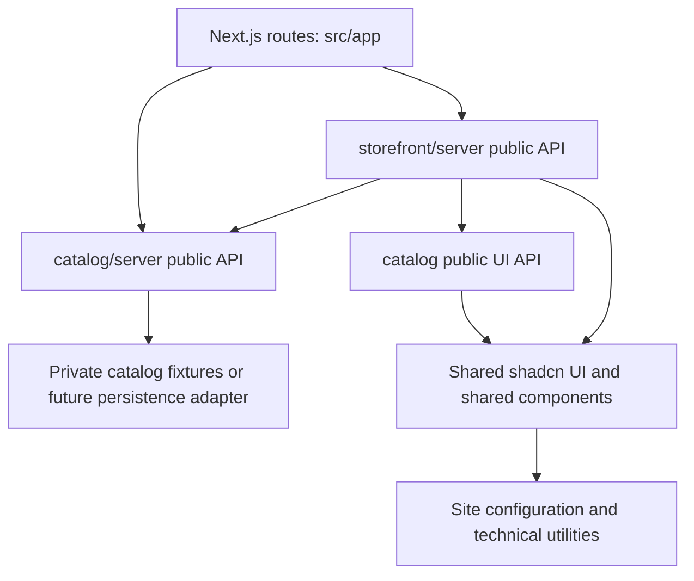

# Architecture

CarCy Shop is a **modular monolith**: one Next.js application, one runtime and
one deployment, with explicit business-module ownership and in-process public
APIs. It is not split into independently deployed services or workspace packages.

Read [the folder structure](folder-structure.md) for file placement and the
[Next.js conventions skill](../.agents/skills/nextjs-conventions/SKILL.md) for
implementation rules. Product and visual truth remain in [PRODUCT.md](../PRODUCT.md)
and [DESIGN.md](../DESIGN.md). This organization retains the storefront interactions while DESIGN.md governs
the requested close match to the selected CarCy prototype.

## Current capabilities

The public storefront builds on the [supplied prototype](prototype-implementation.md)
and follows its selected visual and content direction.
The public product section shows selected owner-supplied product photos in a
vertical carousel. Color previews and motion controls run locally in the browser.
Product details and availability remain unconfirmed. Contact links lead to
Facebook; they do not submit an order.

The `/admin` screen requires a server-configured shared access code. Successful
entry creates a signed, HTTP-only, same-site session cookie that expires after
12 hours. The photo page and each photo API operation check that session;
write requests also require a same-origin `Origin` header. The private code is
stored in the `ADMIN_ACCESS_CODE` environment variable. In production, the photo
manager stores uploaded images and its photo list in a connected public Vercel
Blob store; local development uses `admin/.data/photos.json` and
`public/images/products`. If Blob storage is not connected on Vercel, the admin
photo page displays a setup message and its APIs return `503`. This shared code
is a basic gate, not per-user authentication or a substitute for proper
authentication and rate limiting on a public deployment. If the code is missing
or shorter than 16 characters, the admin screen displays a setup message and
protected APIs return `503` rather than crashing. Durable product storage and
publication workflows remain planned.

## Module ownership

| Module | Owns | Dependencies |
| --- | --- | --- |
| `catalog` | Product contracts, collection filters, concept fixtures, catalog UI, product details, and photo metadata/media persistence; future product validation, management, visibility, and durable product persistence | Shared code only |
| `storefront` | Public page composition, navigation, hero, personalization preview, story, footer, and storefront motion composition | `catalog` through its public APIs, plus shared code |

Future identity or media capabilities become modules when actual requirements
justify them. An admin screen is an experience over business modules, not a second
product domain: product editing and publication belong to `catalog`, and the
future `/admin` routes compose its public management capabilities.

## Dependency direction

- `src/app` is the composition and HTTP entry layer. It imports public module APIs and handles Next.js routing, metadata, and request concerns.
- Modules may use shared UI, utilities, configuration, assets, and technical infrastructure. They must not import `src/app`.
- A module may import another module only through an explicit public entry point and an allowed dependency declared in `eslint.config.mjs`.
- Internal code uses relative imports within its own module. Cross-module relative paths and deep imports into another module's components, data, or types are prohibited.
- Shared code cannot import modules or route files. Extract a genuinely shared capability rather than creating a dependency cycle; the Facebook link and contact destination are shared for this reason.
- Keep the dependency graph acyclic. Adding an allowed edge requires reviewing ownership and the graph, not just silencing a lint error.

## Public APIs and runtime boundaries

Each module exposes only the entry points it needs:

| Entry | Responsibility |
| --- | --- |
| `@/modules/<module>` (`index.ts`) | Small, explicit client-safe component/type/contract exports |
| `@/modules/<module>/server` | Server-only reads, business operations, or server composition; guarded with `import "server-only"` |
| `@/modules/<module>/actions` | Future `"use server"` action entry points; each validates input and authorizes privileged operations |

Do not create unused entry points. Currently `catalog` has client-safe and server
APIs, while `storefront` exposes its server page composition. Public APIs use named
exports, not `export *`. Keep server-only exports out of client-safe barrels.
Public server operations are in-process functions, not automatically HTTP endpoints.
A Server Action or Route Handler is an untrusted entry point even when its module
is otherwise private.

ESLint checks static imports and re-exports for private deep imports, undeclared
module dependencies, reverse dependencies from shared code, and cross-module
relative paths. New module folders default to no module dependencies until their
allowed edges are recorded. Review dynamic imports against the same rules; the
current dynamic imports load Three.js rather than another business module.
Next.js's `server-only` guard additionally prevents guarded code entering a client
bundle. These checks support the architecture; they do not replace authorization.

## Shared UI and infrastructure

`src/components/ui` stays the single source of truth for local shadcn primitives,
preserving `components.json` and its generator aliases. Shared non-domain
compositions live in `src/components/shared`, site-wide constants in `src/config`,
and generic technical helpers in `src/lib`. These are shared facilities, not places
to put product business logic. Shared motion preferences and Framer Motion effects
also live here because both catalog and storefront consume them; catalog does not
import storefront motion internals.

Theme tokens remain in `src/app/globals.css` as the existing Tailwind integration
point. The website's design system customizes local shadcn primitives. Domain UI
lives inside the module that owns its behavior, with presentation organized for
public or admin consumers when needed.

If infrastructure is selected later, shared database/storage SDK clients and
connection lifecycle may live in `src/infrastructure`. Domain-specific queries,
record mapping, and repositories belong to their owning module's private
infrastructure layer. A shared database client does not grant another module
permission to query the owner's tables directly.

## Product reads and mutations

Today the server route composes `storefront/server`, which obtains photo metadata
from `catalog/server` and passes serializable data into catalog UI. Catalog
metadata defaults to private photo fixtures. Local edits use
`admin/.data/photos.json`; production edits use Vercel Blob for both the photo
list and uploaded images. The `/admin/photos` page loads its initial data through
the catalog server API; its client manager uses the admin photo Route Handler for
updates.

When persistence is implemented, keep one product source for storefront and admin.
`catalog` owns product types, validation, visibility rules, state transitions, and
writes. Public queries return only visible products and public fields; direct
product URLs enforce the same visibility rule as listings. Admin queries require
server authorization and must not share private data through public caches.

An admin mutation follows this sequence:

1. The Next.js action/HTTP entry checks the admin session, verifies same-origin writes, and parses untrusted input.
2. The catalog application operation applies domain rules and persists through its private adapter.
3. Relevant public listing/detail caches are invalidated after success, including old slugs or unpublished records.
4. The UI receives a safe typed result and preserves input on failure.

Do not bypass module boundaries with calls to the app's own HTTP endpoints,
client-side database access, duplicate product arrays, or writes into another
module's records. Cross-module collaboration uses the owner's public operation;
add a shared transaction boundary only when a concrete use case needs one.

## Security and failure handling

- Enforce permissions for each privileged read, write, or upload, not only in navigation, layouts, or proxy middleware.
- Configure the shared admin code with the private `ADMIN_ACCESS_CODE` environment variable; never commit its value.
- Keep database clients, private fields, and credentials in guarded server modules.
- Keep reusable schemas and pure types client-safe; validate again on the server and explicitly select writable fields.
- Return actionable field/form errors without exposing internal failures. Confirm success only after persistence succeeds.
- Validate uploads server-side and authorize storage writes when uploads are implemented.
- Respect the installed Next.js caching model; Cache Components and React Compiler are enabled.

Database/ORM, identity provider, deployment infrastructure, and the final product
schema remain open decisions. Vercel Blob is used for current admin photo media
and metadata. Choose additional infrastructure as authorized features require
it. Update this document, file placement guidance, and allowed module edges
together when ownership or dependencies change.
